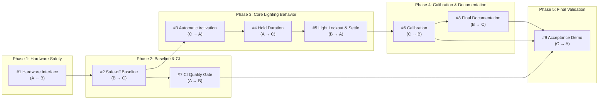

# 3-Person Team Work Plan & Workflow — Smart Touchless Hallway Lighting System

- **GitHub Repository**: [worawalan-s/sensor-based-smart-light](https://github.com/worawalan-s/sensor-based-smart-light)
- **GitHub Issues**: [Issues #1–#7](https://github.com/worawalan-s/sensor-based-smart-light/issues) currently exist; this plan expands the final backlog to **#1–#9**.
- **Reference Documentation**:
  - [README.md](../README.md) — System overview, wiring plan, FSM, and STM32CubeIDE workflow
  - [GLOSSARY.md](../GLOSSARY.md) — Canonical lighting-system vocabulary
  - [ADR 0001](adr/0001-target-nucleo-f411re.md) — NUCLEO-F411RE platform decision
  - [Agent workflow](../AGENTS.md) — Issue-tracker, label, and domain-doc conventions

> **Before starting:** update the live GitHub issues to match the nine tickets in this plan. The issue tracker—not this document—is the final record of ownership, status, and native blocking links.

---

## Team Members and Primary Tracks

Replace `Member A`, `Member B`, and `Member C` with the team’s names and GitHub usernames before work starts.

| Role | Team member | GitHub | Phase progression |
| :---: | :--- | :--- | :--- |
| **`A`** | Member A | `@username` | **P1** Hardware contract (#1) → **P3** Hold Duration (#4) → **P2** CI quality gate (#7) |
| **`B`** | Member B | `@username` | **P2** Safe-off baseline (#2) → **P3** Light Lockout (#5) → **P4** Documentation (#8) |
| **`C`** | Member C | `@username` | **P3** Automatic activation (#3) → **P4** Calibration (#6) → **P5** Acceptance demo (#9) |

---

## 1. Shared Team Checkpoints (`A + B + C`)

### 1.1 Kick-off sync (before Phase 1 — about 30 minutes)

- Read `README.md`, `GLOSSARY.md`, and the NUCLEO-F411RE ADR together.
- Confirm the low-voltage-only test boundary: no mains-connected relay/load testing is part of this project.
- Agree on the evidence required for ticket #1: wiring map, supply voltage, safe 3.3 V STM32-facing signals, logic polarity, and common ground.
- Each member creates one feature branch per assigned issue; no one writes custom firmware outside CubeMX `USER CODE` sections.

### 1.2 Control-behavior sync (after tickets #3 and #4 — about 20 minutes)

- **`C`** demonstrates automatic activation: Ambient Darkness **and** Obstacle Presence turn on the low-voltage load.
- **`A`** demonstrates that continuing Obstacle Presence refreshes the 15-second Hold Duration and that timeout occurs only after presence clears.
- **`B`** reviews the shared behavior before implementing Light Lockout, ensuring the final FSM has a clear handoff from `STATE_LIGHT_ON` to `STATE_OPTICAL_SETTLE`.

### 1.3 Final integration, bench test, and presentation preparation (ticket #9)

- Run the full low-voltage acceptance matrix together: dark/clear, dark/present, bright/present, timer refresh, post-presence timeout, Light Lockout, and post-settle sensing.
- Record calibrated values, pass/fail evidence, and limitations for the final project demonstration.
- Assemble the final presentation evidence: wiring diagram, FSM, calibrated operating values, demonstration photos/video, and each member’s contribution.

---

## 2. Workload Balance Summary (`A`, `B`, `C`)

Each member owns three tickets and reviews three other tickets. The review assignment provides a second pair of eyes at every hardware, firmware, and documentation handoff.

| Member | Implementation owner | Assigned reviewer | Workload rationale |
| :--- | :--- | :--- | :--- |
| **`A`** | **#1** hardware contract, **#4** Hold Duration, **#7** CI gate | **#3**, **#5**, **#9** | Owns electrical safety, deterministic timing, and automated quality checks; reviews the activation path, lockout transition, and final evidence. |
| **`B`** | **#2** safe-off baseline, **#5** Light Lockout, **#8** documentation | **#1**, **#6**, **#7** | Owns the reproducible project foundation and final system documentation; reviews wiring safety, calibration evidence, and CI enforcement. |
| **`C`** | **#3** automatic activation, **#6** calibration, **#9** acceptance demo | **#2**, **#4**, **#8** | Owns the sensor-to-load behavior, measured operating values, and final demonstration; reviews the baseline, timer logic, and documentation accuracy. |

---

## 3. Phase-by-Phase Owner → Reviewer Pairing

### Phase 1: Hardware safety contract

| Ticket | Scope | Owner | Reviewer | Review focus |
| :--- | :--- | :---: | :---: | :--- |
| **#1** | Validate wiring, supply voltages, common ground, pin assignments, logic polarity, and 3.3 V STM32 signal safety. Restrict the prototype to a low-voltage load. | **`A`** | **`B`** | `B` checks that the documented contract is complete enough to configure CubeMX and that no unsafe 5 V GPIO assumption remains. |

> **Early preparation:** `B` may prepare the CubeMX project checklist; `C` may prepare a manual test matrix. Neither begins implementation until the wiring contract is accepted.

### Phase 2: Reproducible baseline and quality gate

| Ticket | Scope | Owner | Reviewer | Review focus |
| :--- | :--- | :---: | :---: | :--- |
| **#2** | Generate a buildable NUCLEO-F411RE project whose low-voltage load starts safe-off after reset. | **`B`** | **`C`** | `C` verifies the configured pins match #1 and the baseline is ready for automatic activation. |
| **#7** | Make GitHub Actions fail on genuine firmware syntax/static-analysis errors while retaining binary-artifact checks. | **`A`** | **`B`** | `B` verifies that a deliberately invalid firmware change fails CI, then is reverted. |

> **Parallel work:** #7 starts only after #2 provides generated firmware files, but it can proceed independently of tickets #3–#6.

### Phase 3: Core touchless lighting behavior

| Ticket | Scope | Owner | Reviewer | Review focus |
| :--- | :--- | :---: | :---: | :--- |
| **#3** | Activate the load only when Ambient Darkness and Obstacle Presence are both observed, using clearly marked provisional threshold/noise values. | **`C`** | **`A`** | `A` verifies the two-condition gate, sensor polarity, and use of the approved low-voltage load. |
| **#4** | Add a non-blocking, retriggerable 15-second Hold Duration. | **`A`** | **`C`** | `C` verifies refresh timing and that the load turns off only 15 seconds after the final presence refresh. |
| **#5** | Add Light Lockout and `STATE_OPTICAL_SETTLE`; Ambient Darkness is evaluated again only after the lamp is off and settling completes. | **`B`** | **`A`** | `A` verifies the lamp cannot cause early shutoff and that the state transition agrees with #4. |

### Phase 4: Calibration and final documentation

| Ticket | Scope | Owner | Reviewer | Review focus |
| :--- | :--- | :---: | :---: | :--- |
| **#6** | Measure the installed modules and finalize the Ambient Darkness threshold, hysteresis/debounce policy, and optical settle period. | **`C`** | **`B`** | `B` verifies values replace #3’s provisional values and boundary behavior is stable. |
| **#8** | Update system documentation with final wiring, FSM, low-voltage boundary, calibration procedure, and operating values. | **`B`** | **`C`** | `C` verifies the documentation reproduces the system that was calibrated in #6. |

### Phase 5: End-to-end validation and presentation evidence

| Ticket | Scope | Owner | Reviewer | Review focus |
| :--- | :--- | :---: | :---: | :--- |
| **#9** | Run the low-voltage acceptance demonstration and record evidence for all specified states and timing behavior. | **`C`** | **`A`** | `A` verifies the result covers the calibrated threshold boundary, Hold Duration, Light Lockout, optical settling, and CI status. |

---

## 4. Workflow & Dependency Graph

---

## 5. Git & Collaboration Rules (Conflict Prevention)

1. **One branch per issue.** Create a branch from updated `main`, for example `codex/issue-4-hold-duration`. Open a pull request that closes its issue and requests review from the assigned reviewer.
2. **Use the handoff rule.** Do not start a blocked ticket until its upstream ticket is merged and its reviewer has accepted the stated deliverable.
3. **Keep CubeMX regeneration safe.** Write custom firmware only within `/* USER CODE BEGIN ... */` and `/* USER CODE END ... */` blocks. Never edit generated regions unless the team explicitly agrees to regenerate and re-check them.
4. **Keep the repository clean.** Do not commit `Debug/`, `Release/`, `.elf`, `.hex`, `.bin`, object files, or other build outputs.
5. **Record evidence in every pull request.** Include `Closes #<issue-number>`, the hardware/test evidence relevant to the ticket, and any calibration values or known limitation.
6. **Check before review.** Run the relevant local build/test before opening a pull request; GitHub Actions must pass before merging.
